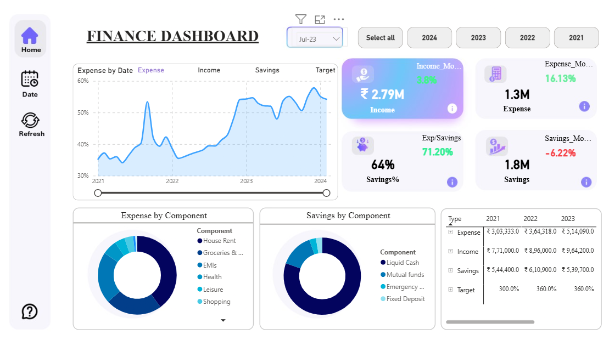
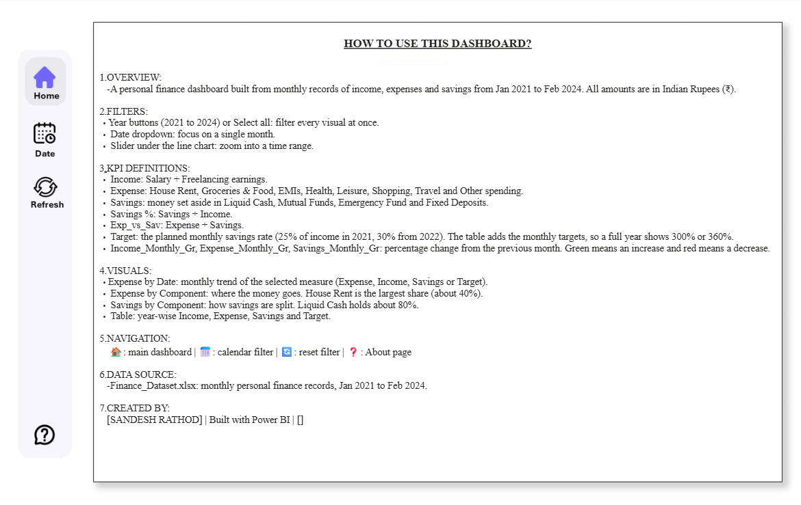

# Personal Finance Dashboard (Power BI)
An interactive Power BI dashboard that tracks personal income, expenses and savings month by month from **January 2021 to February 2024**, and shows where the money goes and how savings are split.



## Table of Contents
- [Objective](#objective)
- [Dashboard Preview](#dashboard-preview)
- [Dataset](#dataset)
- [Data Preparation](#data-preparation)
- [Dashboard Features](#dashboard-features)
- [Key Insights](#key-insights)
- [Tools Used](#tools-used)
- [Repository Structure](#repository-structure)
- [How to Open the Project](#how-to-open-the-project)
- [Limitations and Future Improvements](#limitations-and-future-improvements)
- [Author](#author)

## Objective
To build a one-glance view of personal finances that answers:
1. How much was earned, spent and saved over the period?
2. Which expense categories take the biggest share?
3. How are savings split across instruments?
4. How have income and spending changed from year to year?

## Dashboard Preview

### Home


### Help page


A PDF copy of the dashboard is also available: [Finance_Dashboard.pdf](Finance_Dashboard.pdf)

## Problem
Track income, expenses and savings from Jan 2021 to Feb 2024 and see where money goes.

## Dataset
Source file: [`Data/Finance_Dataset.xlsx`](Data/Finance_Dataset.xlsx)

Monthly records from Jan 2021 to Feb 2024, with one row per component and one column per month. All amounts are in Indian Rupees (₹).Sample data created for this project.

| Type | Components |
|------|------------|
| Income | Salary, Freelancing |
| Expense | House Rent, Groceries & Food, EMIs, Health, Leisure, Shopping, Travel, Other |
| Savings | Liquid Cash, Mutual Funds, Emergency Fund, Fixed Deposit |
| Target | Planned monthly savings rate |

## Data Preparation
- Loaded the Excel file into Power BI using Power Query.
- Converted the wide layout (one column per month) into a long format with Type, Component, Date and Amount columns, so the data can be filtered by date.
- Corrected spelling errors in component names ("Freelancig", "Trevel").
- Set data types and created a date table for time filtering. [Confirm these steps match what you did.]
- Wrote DAX measures for Income, Expense, Savings, Savings %, Expense vs Savings, and month-on-month change.

## Dashboard Features
- **Navigation sidebar:** Home, Date (calendar page), Refresh (reset filters) and Help.
- **Filters:** year buttons (2021 to 2024), Select all, and a month dropdown.
- **KPI cards:** Income, Expense, Savings, Savings % and Expense/Savings, with month-on-month change.
- **Trend chart:** monthly line chart for Expense, Income, Savings or Target, with a time slider.
- **Expense by Component:** donut chart showing the share of each expense category.
- **Savings by Component:** donut chart showing how savings are split.
- **Summary table:** year-wise Income, Expense, Savings and Target.
- **Help page:** explains the filters, KPI definitions and data source for first-time viewers.

  
## Key insights
- **House Rent is the biggest cost:** about 40% of all spending, followed by Groceries & Food (23%) and EMIs (21%). Together these three make up about 85% of expenses.
- **Rent has risen steadily:** monthly rent went from ₹10,000 in 2021 to ₹16,000 by 2023, an increase of 60%.
- **Spending grew faster than income:** yearly expenses rose about 70% from ₹303K (2021) to ₹514K (2023), while income grew about 25% from ₹771K to ₹964K.
- **Spending is taking a larger share of income:** expense as a share of income rose from about 39% in 2021 to 41% in 2022 and 53% in 2023.
- **Savings are mostly held as cash:** Liquid Cash is about 80% of savings, Mutual Funds about 14%, and the Emergency Fund and Fixed Deposits together under 6%.
- **Freelancing is a small income source:** about 6% of total income, with Salary providing the rest.
- **2024 covers only two months** (Jan and Feb), so year-on-year comparisons use 2021 to 2023.


## Tools Used
- Power BI Desktop (data model, visuals, bookmarks, page navigation)
- Power Query (data cleaning and reshaping)
- DAX (measures)
- Microsoft Excel (source data)

## Repository Structure
```
power-bi-personal-finance-dashboard/
├── README.md
├── Finance_Dashboard.pdf
├── Reports/
│   └── Finance_Dashboard.pbix
├── Data/
│   └── Finance_Dataset.xlsx
└── Images/
    ├── home.png
    ├── help.png
    └── demo.gif
```

## How to Open the Project
1. Download `Reports/Finance_Dashboard.pbix`.
2. Open it in **Power BI Desktop** (free to download from Microsoft).
3. If Power BI asks for the data source, point it to `Data/Finance_Dataset.xlsx`.

## Limitations and Future Improvements
- The dataset is small and covers one person, so the insights are descriptive and not meant for forecasting.
- Savings are taken as recorded in the dataset, not calculated as Income minus Expense.
- Possible next steps: add a forecast for expenses, budget vs actual tracking, and category-level drill-through pages.

## Author
[Sandesh Rathod]
